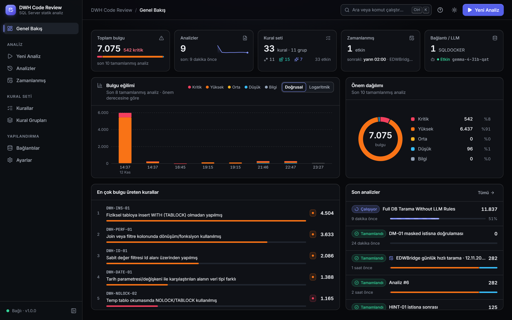
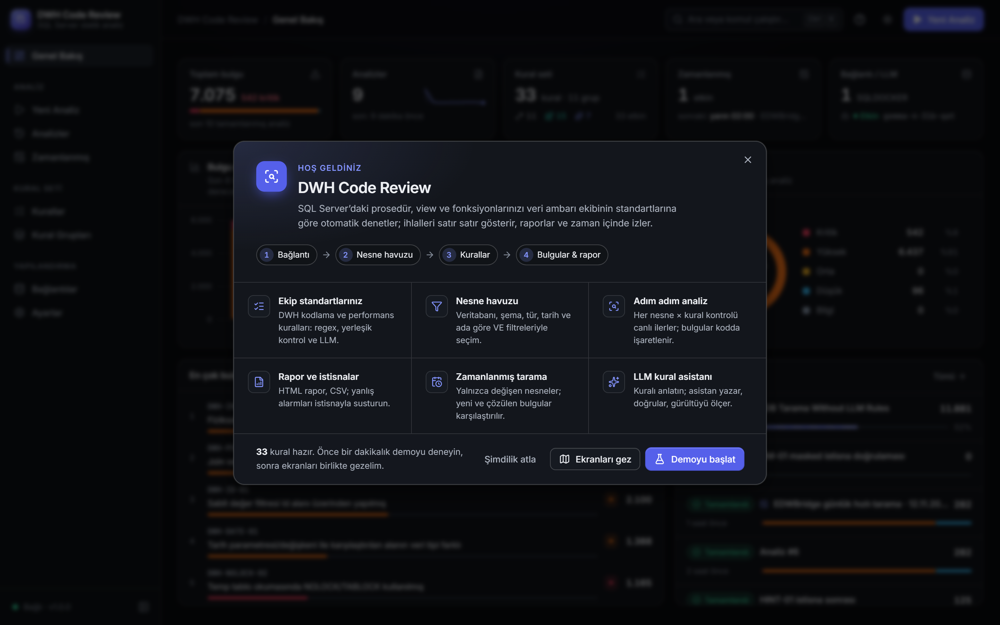
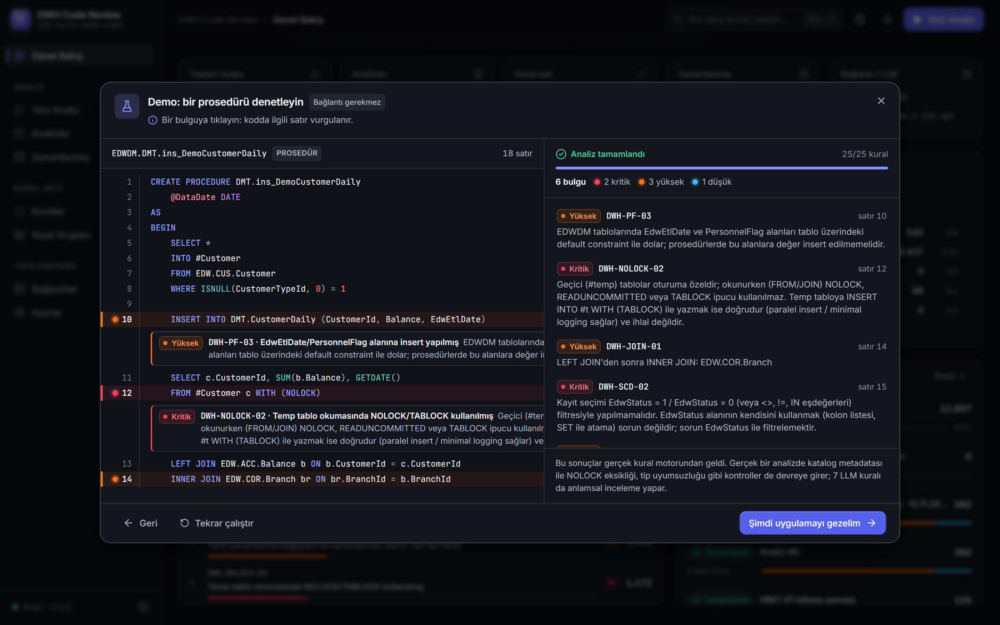
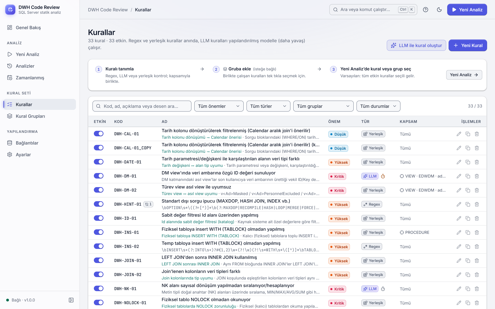
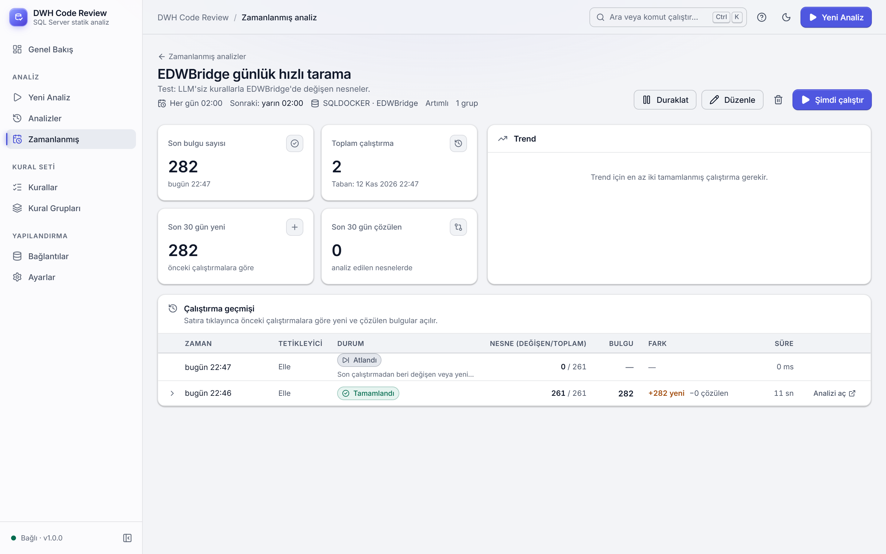
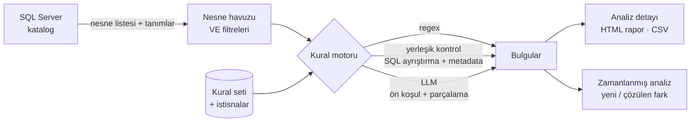

<div align="center">

# DWH Code Review

**SQL Server veri ambarı kodu için kural tabanlı, LLM destekli statik analiz aracı**

Prosedür, view ve fonksiyonlarınızı ekibinizin DWH kodlama standartlarına göre denetler,<br>
ihlalleri satır satır gösterir, raporlar ve zaman içinde izler.


</div>



---

## İçindekiler

- [Neden?](#neden)
- [Özellikler](#özellikler)
- [Ekranlar](#ekranlar)
- [Hızlı başlangıç](#hızlı-başlangıç)
- [Nasıl çalışır?](#nasıl-çalışır)
- [Kural seti](#kural-seti)
- [LLM yapılandırması](#llm-yapılandırması)
- [Proje yapısı](#proje-yapısı)
- [Geliştirme ve testler](#geliştirme-ve-testler)

## Neden?

Veri ambarı kodunda en pahalı hatalar sessiz olanlardır. Okunan tabloya unutulmuş bir `NOLOCK` uzun kilitler doğurur. `EdwStatus = 1` filtresi SCD geçmişini bozar. Filtre kolonuna sarılmış bir `CONVERT` index kullanımını engeller. Elle code review bunların hepsini her seferinde yakalayamaz.

DWH Code Review bu kontrolleri otomatikleştirir:

- Ekip standartlarını **çalıştırılabilir kurallara** dönüştürür.
- Bu kuralları SQL Server'daki gerçek nesnelere **adım adım** uygular.
- Sonuçları **izlenebilir** kılar: hangi kural, hangi nesne, hangi satır.

Uygulama yerel ve tek kullanıcılıdır. Giriş ekranı yoktur; açıldığında doğrudan Genel Bakış gelir.

## Özellikler

| | |
|---|---|
| 🧩 **Üç tür kural** | **Regex**: anlık ve deterministik. **Yerleşik kontrol**: SQL ayrıştırma ve katalog metadatası. **LLM**: anlamsal inceleme. Her kuralın önem derecesi, kapsamı (nesne tipi, veritabanı, ad deseni) ve canlı test örneği vardır. |
| 🗂️ **Nesne havuzu** | Nesneleri veritabanı, şema, tür, oluşturma/değiştirme tarihi ve ada göre filtreleyin. Tüm filtreler **VE** ile birleşir; farklı sorgulardan havuza ekleme yapılabilir. |
| ▶️ **Adım adım analiz** | Havuz × kurallar = kontrol listesi. Analiz arka planda ilerler, ilerleme canlı izlenir, bulgular kaynak kodda satırına işaretlenir. |
| 📄 **Rapor** | Sekmeli, kendi içinde çalışan HTML raporu (Özet / Bulgular / Kurallar / Nesneler) ve CSV dışa aktarımı. |
| 🔕 **İstisnalar** | Yanlış alarmı bulgunun üzerinden istisna tanımlayarak susturun; sonraki analizlerde gizlenir ve sayısı raporlanır. |
| 🗓️ **Zamanlanmış analiz** | Kapsamı ve kuralları bir kez tanımlayın. Sistem periyodik olarak **yalnızca değişen veya yeni nesneleri** tarar ve önceki çalıştırmaya göre **yeni/çözülen** bulguları gösterir. |
| ✨ **LLM kural asistanı** | Ne denetlenmesini istediğinizi yazın ve örnek verin. Asistan mevcut kurallarla karşılaştırır, taslak çıkarır, örneklerle doğrular, gerçek nesnelerde gürültü testi yapar ve **onayınız olmadan kaydetmez**. |
| 🧭 **Tanıtım turu** | İlk girişte açılır: bağlantı gerektirmeyen canlı demo, ekranlar arası spot ışıklı tur ve "Nereden başlamalı?" listesi. |
| 🌗 **Modern arayüz** | Koyu/açık tema (WCAG AA kontrastı), komut paleti (`Ctrl+K`), akordiyon kural seçimi, log ölçekli trend grafiği. |

## Ekranlar

<table>
  <tr>
    <td width="50%"><br><sub><b>Tanıtım turu</b>: ilk girişte uygulamayı ve akışı tanıtır.</sub></td>
    <td width="50%"><br><sub><b>Canlı demo</b>: gerçek kural seti örnek bir prosedürde çalışır, bulgular satırına işlenir.</sub></td>
  </tr>
  <tr>
    <td width="50%"><br><sub><b>Kurallar</b>: tür, önem, kapsam; LLM ile kural oluşturma.</sub></td>
    <td width="50%"><br><sub><b>Zamanlanmış analiz</b>: artımlı tarama ve çalıştırmalar arası fark.</sub></td>
  </tr>
</table>

## Hızlı başlangıç

### Gereksinimler

- Windows (SQL istemci alias çözümlemesi için; backend diğer platformlarda da çalışır)
- Python **3.12+**
- Node.js **22+**
- **ODBC Driver 18** (veya 17) for SQL Server
- *İsteğe bağlı:* OpenAI uyumlu bir LLM uç noktası (LM Studio, Ollama, vLLM, OpenAI…)

### Çalıştırma

```powershell
.\start.ps1
```

İlk çalıştırmada Python sanal ortamını ve npm paketlerini kurar. Ardından iki sunucu açılır:

| Servis | Adres |
|---|---|
| Arayüz | http://localhost:5173 |
| API | http://127.0.0.1:8000 |

<details>
<summary>Elle başlatmak için</summary>

```powershell
# backend
cd app\backend
py -3.12 -m venv .venv
.venv\Scripts\python -m pip install -r requirements.txt
.venv\Scripts\python -m uvicorn app.main:app --port 8000

# frontend (ayrı terminal)
cd app\frontend
npm install
npm run dev
```

</details>

### İlk adımlar

1. **Bağlantılar** sayfasında SQL Server bağlantısı ekleyin. Sunucu adı, SQL istemci alias'ı veya `host,port` yazılabilir; **Test et** ile doğrulayın.
2. *(İsteğe bağlı)* **Ayarlar** sayfasında LLM uç noktasını tanımlayın.
3. **Yeni Analiz** ile kaynağı seçin, nesne havuzunu filtreleyin, kural grubunu seçin ve başlatın.

> [!TIP]
> Büyük havuzlarda **Hızlı Tarama (LLM'siz)** grubunu kullanın. LLM kurallarını ise seçili nesnelerde derin inceleme için çalıştırın.

## Nasıl çalışır?



- **Kaynağa yalnızca okuma yapılır.** Nesne tanımları `sys.sql_modules` ve katalog görünümlerinden alınır.
- **Regex kuralları**, yorumlar ve string sabitleri maskelendikten sonra çalışır. `match` (desen bulunursa ihlal) veya `absent` (desen yoksa ihlal) modunda olabilirler.
- **Yerleşik kontroller** SQL'i ayrıştırır ve katalog metadatasını kullanır: kolon tipleri, Id/Nk çiftleri, SCD tabloları, `scd.mrg*` prosedürleri.
- **LLM kuralları** yalnızca ön koşul regex'i eşleşen nesnelere gönderilir. Büyük nesneler, örtüşen parçalar halinde bağlam bilgisiyle gönderilir.
- **Zamanlanmış analizler**, değişiklik tarihine dayalı bir filigranla yalnızca yeni veya değişen nesneleri alır. Bulgular satır numarasından bağımsız karşılaştırılır.

## Kural seti

Uygulama, veri ambarı ekibinin standartlarından türetilmiş **32 kural** ve **11 grup** ile gelir. Tüm kurallar arayüzden düzenlenebilir, kapatılabilir veya çoğaltılabilir.

<details>
<summary><b>Kuralların tam listesi</b></summary>

| Kod | Kural | Önem | Tür |
|---|---|---|---|
| `DWH-CAL-01` | Tarih kolonu dönüştürülerek filtrelenmiş (Calendar aralık join'i önerilir) | Düşük | Yerleşik |
| `DWH-DATE-01` | Tarih parametresi/değişkeni ile karşılaştırılan alanın veri tipi farklı | Yüksek | Yerleşik |
| `DWH-DM-01` | DM view'ında veri ambarına özgü ID değeri sunuluyor | Kritik | LLM |
| `DWH-DM-02` | Türev view asıl view ile uyumsuz | Kritik | Yerleşik |
| `DWH-HINT-01` | Standart dışı sorgu ipucu (MAXDOP, HASH JOIN, INDEX vb.) | Yüksek | Regex |
| `DWH-ID-01` | Sabit değer filtresi Id alanı üzerinden yapılmış | Yüksek | Yerleşik |
| `DWH-INS-01` | Fiziksel tabloya insert WITH (TABLOCK) olmadan yapılmış | Yüksek | Yerleşik |
| `DWH-INS-02` | Temp tabloya insert WITH (TABLOCK) olmadan yapılmış | Yüksek | Regex |
| `DWH-JOIN-01` | LEFT JOIN'den sonra INNER JOIN kullanılmış | Yüksek | Yerleşik |
| `DWH-JOIN-02` | Join'lenen kolonların veri tipleri farklı | Yüksek | Yerleşik |
| `DWH-NK-01` | NK alanı sayısal dönüşüm yapılmadan sıralanıyor/hesaplanıyor | Kritik | LLM |
| `DWH-NOLOCK-01` | Fiziksel tablo NOLOCK olmadan okunuyor | Kritik | Yerleşik |
| `DWH-NOLOCK-02` | Temp tablo okumasında NOLOCK/TABLOCK kullanılmış | Kritik | Regex |
| `DWH-PART-01` | Partition silme yöntemi standarda uygun değil | Kritik | LLM |
| `DWH-PERF-01` | Join veya filtre kolonunda dönüşüm/fonksiyon kullanılmış | Yüksek | Yerleşik |
| `DWH-PERF-02` | View çıktısı kolon dönüşümüyle üretilmiş (index kullanılamaz) | Yüksek | Regex |
| `DWH-PERF-03` | JOIN veya WHERE koşulunda OR kullanılmış | Yüksek | Yerleşik |
| `DWH-PERF-04` | LIKE başında joker karakter (%) ile kullanılmış | Yüksek | Regex |
| `DWH-PERF-05` | CURSOR ile satır satır işlem | Yüksek | Regex |
| `DWH-PERF-06` | NOT IN (SELECT ...) kullanılmış | Yüksek | Regex |
| `DWH-PERF-07` | Sorgu içinde scalar fonksiyon (UDF) çağrılmış | Yüksek | Yerleşik |
| `DWH-PF-01` | Asıl view'da PersonnelFlag kaynağı standarda uygun değil | Yüksek | Yerleşik |
| `DWH-PF-02` | EDWDM prosedüründe PersonnelFlag LKP tablosu kullanılmış | Yüksek | Regex |
| `DWH-PF-03` | EdwEtlDate/PersonnelFlag alanına insert yapılmış | Yüksek | Regex |
| `DWH-SCD-01` | SCD tablo geçerlilik aralığı filtresi hatalı veya eksik | Kritik | LLM |
| `DWH-SCD-02` | EdwStatus ile kayıt filtrelenmiş | Kritik | Regex |
| `DWH-SQL-01` | Gereksiz DISTINCT kullanımı | Yüksek | LLM |
| `DWH-SQL-02` | SELECT listesinde alt sorgu (subselect) kullanılmış | Yüksek | Yerleşik |
| `DWH-SQL-03` | Final veri seti temp tablo üzerinden çift insert ediliyor | Yüksek | LLM |
| `DWH-SQL-04` | COUNT(*) kullanılmış | Yüksek | Regex |
| `DWH-SQL-05` | Gereksiz UNION (UNION ALL yerine) | Yüksek | LLM |
| `DWH-SQL-06` | ROW_NUMBER/RANK ORDER BY alanı sıralamaya uygun değil | Yüksek | Yerleşik |

</details>

<details>
<summary><b>Kural grupları</b></summary>

| Grup | Kural | Açıklama |
|---|---|---|
| Hızlı Tarama (LLM'siz) | 26 | Tüm regex ve yerleşik kurallar; LLM çağrısı yapmaz, büyük analizler için |
| DWH Standartları | 8 | Veri ambarı ekibinin zorunlu kodlama standartları |
| DWH Kodlama ve Performans | 25 | Önemli kodlama ve performans kuralları |
| Sorgu Performansı | 14 | Index kullanımını ve sorgu planını etkileyen kullanımlar |
| LLM Kuralları | 7 | Model ile yorumlanan kurallar; derin inceleme için (yavaş) |
| DM Katmanı ve PersonnelFlag | 6 | EDWDM view/prosedür standartları, türev view uyumu |
| Anahtarlar (Id / Nk) | 5 | Vekil (Id) ve doğal (Nk) anahtarların doğru kullanımı |
| Kilit ve Sorgu İpuçları | 5 | NOLOCK / TABLOCK ve standart dışı ipuçları |
| Partition ve Yükleme | 5 | Partition truncate/silme ve yükleme standartları |
| SCD ve Tarih | 5 | SCD geçerlilik aralığı, EdwStatus, tarih değişkeni ve Calendar |
| Kod Yazım Standartları | 4 | Okunabilirlik ve ekip yazım standartları |

</details>

Bir kural birden fazla grupta yer alabilir. Kendi kurallarınızı **Yeni Kural** ile elle veya **LLM ile kural oluştur** asistanıyla ekleyebilirsiniz.

## LLM yapılandırması

**Ayarlar → LLM ayarları** bölümünde OpenAI uyumlu herhangi bir uç nokta tanımlanabilir:

| Alan | Örnek |
|---|---|
| Base URL | `http://localhost:1234/v1` (LM Studio), `http://localhost:11434/v1` (Ollama) |
| Model | Sunucudan otomatik listelenir |
| Zaman aşımı | Büyük modeller için 300–600 sn önerilir |
| Parça büyüklüğü | Bir LLM çağrısına gönderilecek en fazla satır (varsayılan 500) |

API anahtarı Fernet ile şifrelenerek saklanır ve arayüze geri gönderilmez. LLM tanımlanmadan da regex ve yerleşik kurallar eksiksiz çalışır.

## Proje yapısı

```
.
├── start.ps1                  # backend + frontend'i başlatır
├── app/
│   ├── API_CONTRACT.md        # backend ↔ frontend API sözleşmesi
│   ├── backend/               # FastAPI + SQLAlchemy (SQLite) + pyodbc
│   │   ├── app/
│   │   │   ├── routers/       # REST uçları
│   │   │   ├── services/      # kural motoru, yerleşik kontroller, LLM, katalog, rapor, zamanlayıcı
│   │   │   ├── seed.py        # varsayılan kurallar ve gruplar
│   │   │   └── migrations.py  # sürümlü şema geçişleri
│   │   ├── data/              # SQLite + şifreleme anahtarı (git'e girmez)
│   │   └── tests/
│   └── frontend/              # React 19 + Vite + Tailwind CSS 4 + TanStack Query
│       └── src/
│           ├── pages/
│           ├── components/
│           └── lib/
├── dev/sqlserver/seed.sql     # test için örnek DWH nesneleri
└── docs/screenshots/
```

Uygulama verisi `app/backend/data/` altındadır. Bu klasör silinirse uygulama varsayılan kurallar ve gruplarla sıfırdan başlar.

## Geliştirme ve testler

```powershell
# backend
cd app\backend
.venv\Scripts\python -m pip install -r requirements-dev.txt
.venv\Scripts\python -m pytest

# frontend
cd app\frontend
npm test            # vitest
npm run typecheck   # tsc
npm run lint        # eslint
```

### Test SQL Server (isteğe bağlı)

`dev/sqlserver/seed.sql`, kurallara takılan ve takılmayan örnek nesnelerle iki veritabanı oluşturur: `SalesDWH` ve `FinanceDWH`. Docker ile bir SQL Server 2022 konteyneri çalıştırıp betiği `sqlcmd` ile yükleyebilirsiniz.

---

<div align="center"><sub>Veri ambarı ekipleri için yerel, kural tabanlı code review.</sub></div>
